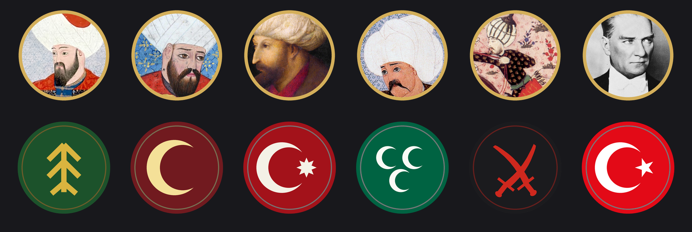
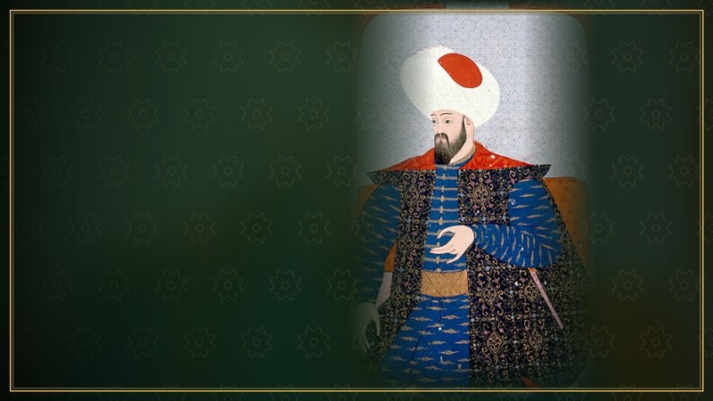
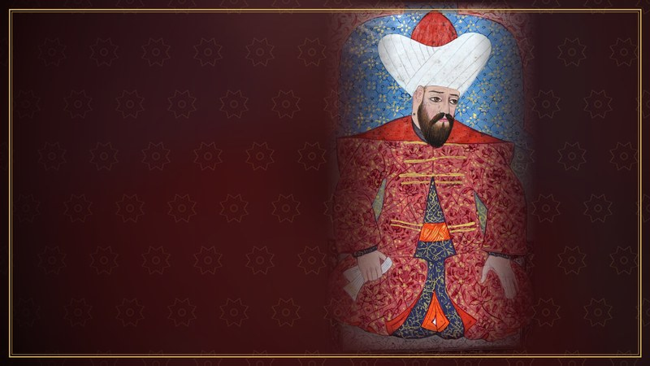
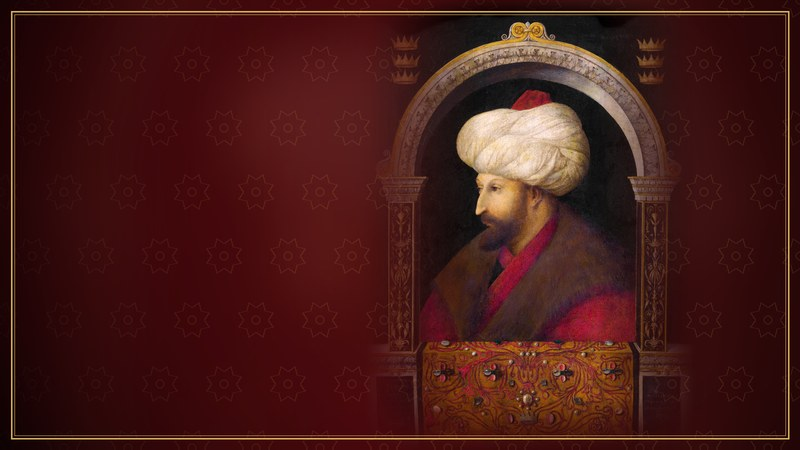
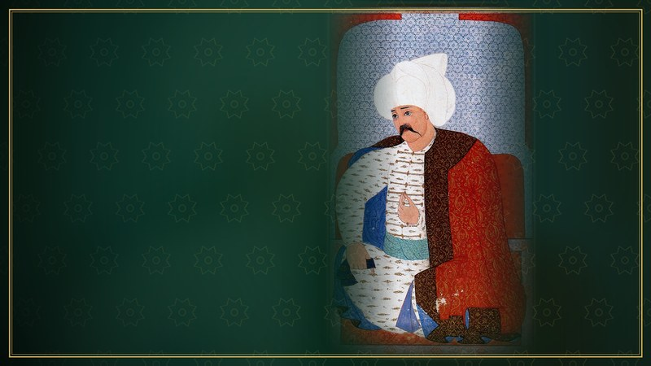
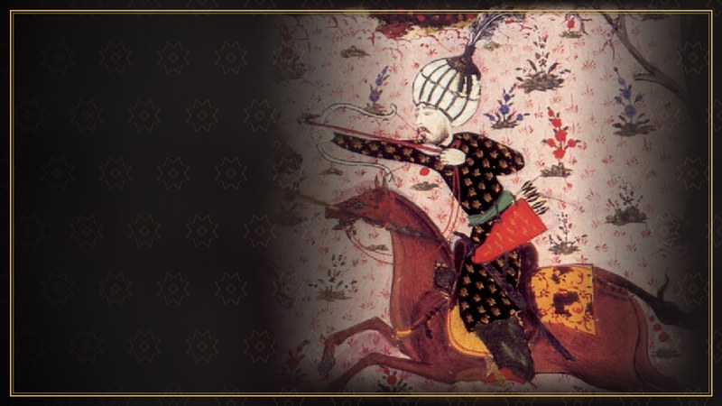
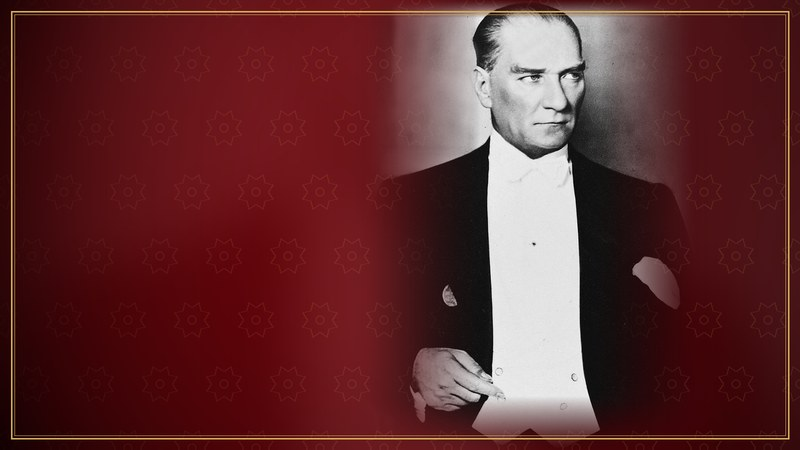
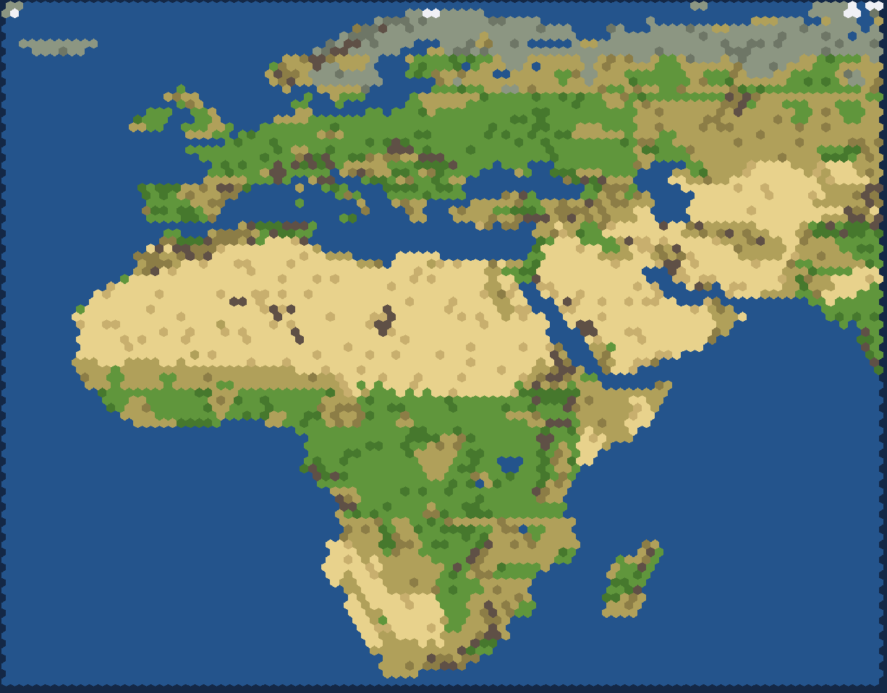

# Türk Liderleri: Civilization V Modu

*Sid Meier's Civilization V: Brave New World* için altı Türk lideri ve gerçek coğrafyaya dayanan bir Avrupa, Orta Doğu ve Afrika haritası ekleyen mod.



## İçerik

| Lider | Medeniyet | Yetenek | Benzersiz birim | Benzersiz bina |
|---|---|---|---|---|
| **Osman Bey** | Kayı Beyliği | **Kuruluş Rüyası:** Sınırlar %33 daha hızlı genişler. Her şehir +1 Gıda üretir. | **Kayı Akıncısı** (Atlı yerine): +1 hareket | **Zaviye** (Tapınak yerine): +1 Gıda |
| **Orhan Gazi** | Osmanlı Beyliği | **İlk Düzenli Ordu:** Yakın dövüş ve barutlu birimler %25 daha hızlı üretilir ve +10 deneyimle başlar. Kara birimlerinin bakım masrafı %25 daha azdır. | **Yaya** (Mızrakçı yerine): +1 güç, ücretsiz Talim I | **Medrese** (Kütüphane yerine): +1 Bilim, +1 Kültür |
| **Fatih Sultan Mehmet** | Osmanlı Devleti | **Kuşatma Ustası:** Kuşatma birimleri şehirlere karşı +%30 güç kazanır. Fethedilen şehirde direniş yarıya iner; nüfus x 10 Altın kazanılır. | **Şahi Topu** (Mancınık yerine): +4 menzilli, +2 yakın güç | **Kapalıçarşı** (Pazar yerine): +2 Altın, +1 Mutluluk |
| **Yavuz Sultan Selim** | Osmanlı Hilafeti | **Halifelik:** Öldürülen düşmanların gücünün %50'si kadar İnanç kazanılır. Fethedilen her şehir nüfus x 15 İnanç kazandırır. | **Tüfekendaz** (Tüfekçi yerine): +2 güç, atlılara karşı +%33 | **Külliye** (Mabet yerine): +1 Kültür, +1 Gıda |
| **Seyyid Battal Gazi** | Uç Gazileri | **Destan Kahramanı:** Yakın dövüş ve atlı birimler dost topraklar dışında +%15 güç kazanır. Büyük General üretimi +%50, yağma altını +%100. | **Gazi** (Kılıçlı yerine): +1 güç, ücretsiz Şok I | **Ribat** (Sur yerine): +3 savunma, +25 can, +15 deneyim |
| **Mustafa Kemal Atatürk** | Türkiye Cumhuriyeti | **Cumhuriyet İnkılapları:** Tüm şehirlerde Bilim ve Kültür +%10. Kara birimleri dost topraklarda +%15 güç kazanır. | **Mehmetçik** (Büyük Savaş Piyadesi yerine): +5 güç, dost topraklarda +%25 | **Halkevi** (Halk Okulu yerine): +2 Kültür |

Her liderin ayrıca şunları vardır:
- Diplomasi ekranı ve yükleme (Dawn of Man) ekranı görseli
- Türkçe giriş metni, Civilopedia sayfası ve diplomasi sözleri
- 20 tarihî şehir adı ve 10 casus adı
- Kendine özgü yapay zekâ kişiliği (ör. Yavuz saldırgan, Atatürk barışçı ve bilim odaklı)

Oyundaki Osmanlı medeniyeti (Kanuni Sultan Süleyman) olduğu gibi kalır.

### Lider ekranları

| | |
|---|---|
|  |  |
|  |  |
|  |  |

## Harita: Türk Dünyası (Avrupa, Orta Doğu ve Afrika)



- 100 x 90 altıgen. Batıda Atlantik ve İzlanda'dan doğuda Orta Asya ve Hindistan'ın kuzeybatısına, kuzeyde İskandinavya'dan güneyde Ümit Burnu'na kadar uzanır.
- Kara, göller, çöller ve dağ sıraları [Natural Earth](https://www.naturalearthdata.com/) verisinden üretilmiştir.
- İstanbul ve Çanakkale boğazları, Cebelitarık ve Hürmüz açıktır; Karadeniz Akdeniz'e bağlıdır. Süveyş karadır.
- **Tarihî başlangıç noktaları** seçeneği varsayılan olarak açıktır. Türk liderleri ve bölgedeki diğer medeniyetler (Bizans, Yunan, Roma, Mısır, Arabistan, İran vb.) gerçek başkentlerine en yakın uygun karede başlar. Liderler arasında en az 6 kare mesafe korunur; Anadolu'da yer kalmazsa lider karadan en yakın uygun bölgeye kaydırılır.
- Önerilen harita boyutu: **Devasa (Huge)**.

## Kurulum

1. GitHub sayfasında **Code > Download ZIP** ile modu indirin.
2. Arşivden `Turkish Leaders` klasörünü şu konuma kopyalayın:
   - Windows: `Belgeler\My Games\Sid Meier's Civilization 5\MODS\`
   - macOS: `~/Documents/Aspyr/Sid Meier's Civilization 5/MODS/`
3. Oyunu açın, **MODS** menüsüne girin ve **Türk Liderleri (Turkish Leaders)** modunu işaretleyin.
4. **Tek Oyuncu > Oyun Kur** ekranında liderinizi seçin. Haritayı kullanmak için harita türü olarak **Türk Dünyası: Avrupa, Orta Doğu ve Afrika** seçin.

**Gereksinim:** Brave New World genişlemesi.

## Hata bildirimi

Mod gerçek oyunda henüz test edilmedi. Sorun yaşarsanız günlük kayıtlarını açıp bana gönderin:

1. `Belgeler\My Games\Sid Meier's Civilization 5\config.ini` dosyasında `LoggingEnabled = 1` yapın.
2. Oyunu açıp modu yükleyin.
3. `Belgeler\My Games\Sid Meier's Civilization 5\Logs\` klasöründeki **Database.log** ve **Lua.log** dosyalarını gönderin.

## Bilinen sınırlamalar

- Liderler 3D ve animasyonlu değil, hareketsiz 2D görsellerdir. Orijinal oyundaki animasyonlu liderler 3D modelleme gerektirir.
- 2D liderlerde Civ V motoru diplomasi seslendirmesini çalmaz; diplomasi sözleri yazılı olarak görünür.
- Benzersiz birim ve binalar, yerini aldıkları birimin simgesini ve 3D modelini kullanır. Şahi Topu top modeliyle, Tüfekendaz yeniçeri modeliyle görünür.
- Battal Gazi'nin günümüze ulaşmış bir portresi yoktur. Onun yerine 16. yüzyıl Süleymannâme'sinden bir akıncı beyi minyatürü temsilî olarak kullanılmıştır.
- Fatih ve Yavuz'un fetih bonusları ile Osman, Orhan ve Atatürk'ün şehir bonusları Lua betiğiyle çalışır. Çok oyunculu modda bu betikler her oyuncuda ayrı çalıştığı için uyumsuzluk riski vardır; mod öncelikle tek oyunculu oyun için tasarlanmıştır.
- Oyunda Türkçe dil seçeneği bulunmadığından metinler İngilizce dil tablosuna yazılmıştır. Oyun hangi dilde olursa olsun Türkçe görünür.
- Civ V'in yazı tipinde ş, ğ ve ı harfleri yoktur. Bu harfler oyunda s, g ve i olarak yazılır (ör. "Başlangıç" yerine "Baslangiç"). ç, ö ve ü olduğu gibi görünür.

## Geliştirici notları

Tüm üretilen dosyalar `tools/` klasöründeki betiklerle yeniden oluşturulabilir:

```bash
pip install pillow shapely lupa
```

```bash
python3 tools/build_text.py && python3 tools/build_gameplay.py
```

```bash
python3 tools/build_art.py
```

```bash
python3 tools/build_map.py --assemble
```

```bash
python3 tools/test_sql.py && python3 tools/test_lua.py
```

```bash
python3 tools/build_modinfo.py
```

- `tools/texts.py`: Tüm Türkçe metinler, şehir ve casus adları, diplomasi sözleri.
- `tools/build_gameplay.py`: Medeniyet, lider, yetenek, renk, simge ve isim verilerini XML olarak üretir (`Core/TL_Gameplay.xml`, `Core/TL_Extras.xml`). Benzersiz birim ve binalar, oyundaki temel satırı kopyaladıkları için SQL dosyalarındadır.
- `tools/build_map.py`: Natural Earth verisinden harita ızgarasını (`tools/emea_grid.txt`) üretir ve `tools/map_template.lua` ile birleştirir. Izgarayı yeniden üretmek için Natural Earth GeoJSON klasörünü argüman olarak verin.
- `tools/test_sql.py` ve `tools/test_lua.py`: SQL dosyalarını sahte bir veritabanında, Lua betiklerini taklit edilmiş bir Civ V API'siyle (Lua 5.1) çalıştırır. Gerçek oyundaki testin yerini tutmaz, ama sözdizimi ve mantık hatalarını erken yakalar.
- `tools/build_modinfo.py`: Dosyaların MD5 değerlerini hesaplayıp `.modinfo` dosyasını yazar. Herhangi bir dosyayı değiştirdikten sonra çalıştırın.

Görsel ve veri kaynakları için [docs/KAYNAKLAR.md](docs/KAYNAKLAR.md) dosyasına bakın.
